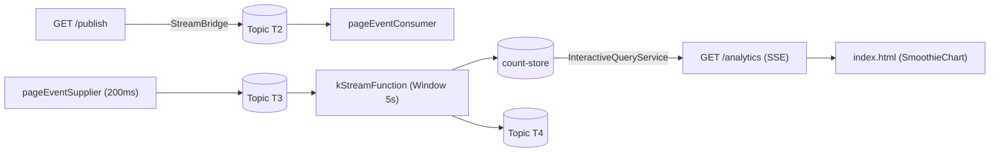
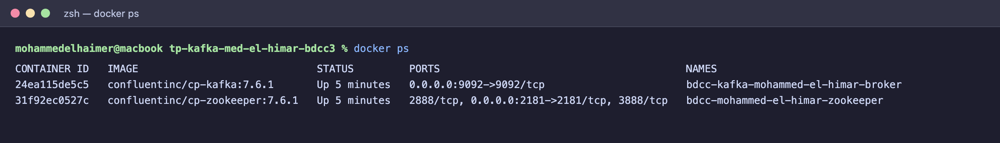
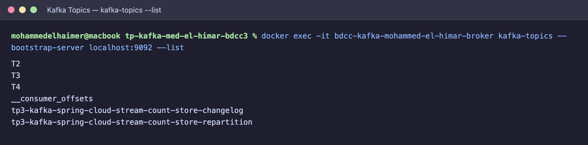
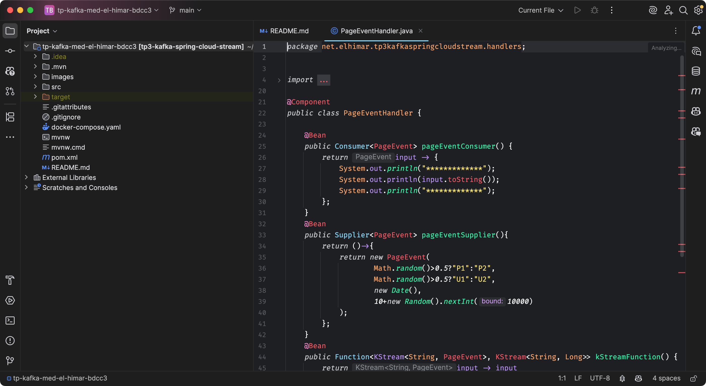
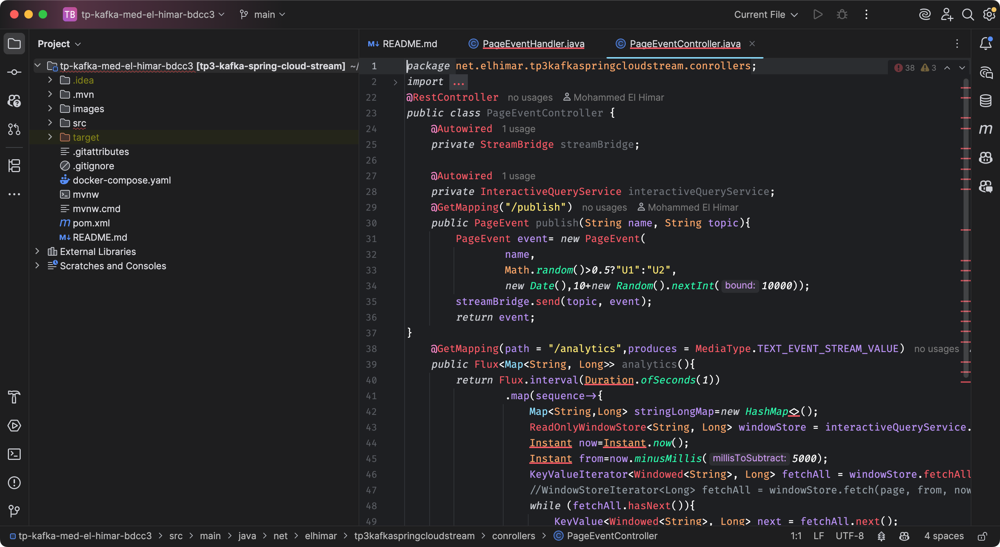
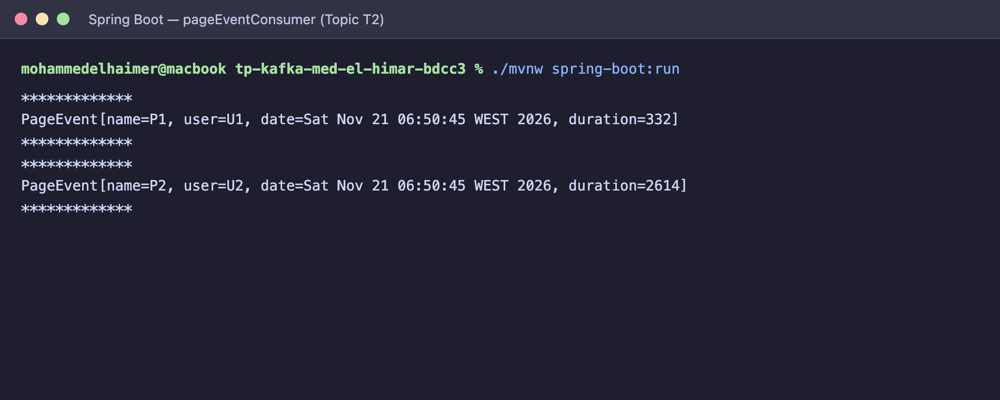
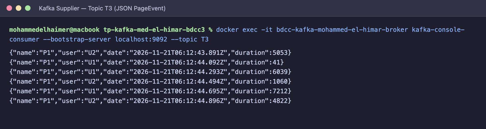
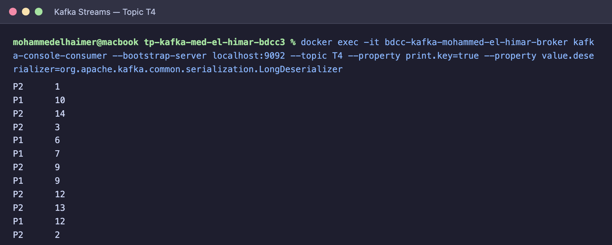
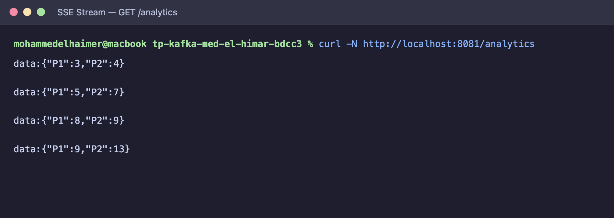

# TP3 — Apache Kafka & Spring Cloud Stream

**Réalisé par :** Mohammed EL HIMAR  
**Filière :** BDCC III — Systèmes Distribués (SSD)

---

## Présentation du projet

Ce TP met en œuvre une architecture orientée événements (*Event-Driven Architecture*) avec **Apache Kafka**, **Spring Cloud Stream** et **Kafka Streams** :

- **Producer REST** (`StreamBridge`) publiant des événements `PageEvent` vers un topic Kafka (`T2`).
- **Consumer** (`Consumer<PageEvent>`) consommant les événements depuis `T2`.
- **Supplier** (`Supplier<PageEvent>`) générant automatiquement des événements aléatoires toutes les `200 ms` vers `T3`.
- **Kafka Streams** (`Function<KStream<String, PageEvent>, KStream<String, Long>>`) comptant en temps réel le nombre de visites par page sur une fenêtre glissante de **5 secondes** (`T3` → `count-store` → `T4`).
- **Analytics temps réel** exposés via **Server-Sent Events (SSE)** (`GET /analytics`) grâce à `InteractiveQueryService`, visualisés en direct avec **SmoothieChart**.

### Architecture globale



### Stack technique
- **Java 21** & **Spring Boot 4.1.1**
- **Spring Cloud Stream** (`2025.1.3`) — Binders Kafka & Kafka Streams
- **Apache Kafka & Zookeeper** (`confluentinc/cp-kafka:7.6.1`, `confluentinc/cp-zookeeper:7.6.1`) via Docker Compose
- **Project Reactor** (`Flux` / `TEXT_EVENT_STREAM_VALUE`) & **Smoothie.js**

### Structure du projet
```text
├── docker-compose.yaml
├── pom.xml
└── src/main/
    ├── java/net/elhimar/tp3kafkaspringcloudstream/
    │   ├── Tp3KafkaSpringCloudStreamApplication.java
    │   ├── events/PageEvent.java
    │   ├── conrollers/PageEventController.java
    │   └── handlers/PageEventHandler.java
    └── resources/
        ├── application.properties
        └── static/index.html
```

---

## 1. Démarrage de Kafka & Zookeeper (Docker Compose)

Le fichier `docker-compose.yaml` déploie un broker Kafka (`9092`) et Zookeeper (`2181`) avec les images Confluent `7.6.1`.

```bash
docker compose up -d
docker ps
```



Vérification des topics créés dans le broker (`T2`, `T3`, `T4` ainsi que les topics internes du state store `count-store`) :

```bash
docker exec -it bdcc-kafka-mohammed-el-himar-broker \
  kafka-topics --bootstrap-server localhost:9092 --list
```



---

## 2. Implémentation dans IntelliJ IDEA

### Handlers (`PageEventHandler.java`)
Définition des trois beans fonctionnels déclarés dans `application.properties` (`spring.cloud.function.definition=pageEventConsumer;pageEventSupplier;kStreamFunction`) :
- `pageEventConsumer` : affiche chaque `PageEvent` reçu sur `T2`.
- `pageEventSupplier` : produit des événements `P1`/`P2` (`U1`/`U2`) toutes les `200 ms` sur `T3`.
- `kStreamFunction` : regroupe par nom de page, applique une fenêtre temporelle de 5 secondes (`TimeWindows.ofSizeWithNoGrace(Duration.ofSeconds(5))`), matérialise le compteur dans `count-store` et publie les résultats sur `T4`.



### Contrôleur REST & SSE (`PageEventController.java`)
- `GET /publish?name=P1&topic=T2` : publie un événement à la demande via `StreamBridge`.
- `GET /analytics` (`text/event-stream`) : interroge le `ReadOnlyWindowStore` (`count-store`) chaque seconde sur les 5 dernières secondes via `InteractiveQueryService`.



---

## 3. Publication d'un événement via REST (`GET /publish`)

Appel de l'endpoint `http://localhost:8081/publish?name=P1&topic=T2` :


---

## 4. Consommation des événements (`pageEventConsumer`)

Réception immédiate des événements publiés sur le topic `T2` dans la console Spring Boot :



---

## 5. Production automatique d'événements (`pageEventSupplier` — Topic `T3`)

Lecture des événements JSON produits toutes les `200 ms` sur `T3` :

```bash
docker exec -it bdcc-kafka-mohammed-el-himar-broker \
  kafka-console-consumer --bootstrap-server localhost:9092 --topic T3
```



---

## 6. Agrégation temps réel avec Kafka Streams (Topic `T4`)

Lecture du flux agrégé (`clé = nom de page`, `valeur = nombre de visites sur 5s`) sur le topic `T4` :

```bash
docker exec -it bdcc-kafka-mohammed-el-himar-broker \
  kafka-console-consumer --bootstrap-server localhost:9092 \
  --topic T4 \
  --property print.key=true \
  --property value.deserializer=org.apache.kafka.common.serialization.LongDeserializer
```



---

## 7. Analytics en temps réel (SSE & SmoothieChart)

Flux Server-Sent Events retourné par `GET http://localhost:8081/analytics` :

```bash
curl -N http://localhost:8081/analytics
```



Visualisation graphique en temps réel sur `http://localhost:8081/` (`P1` en vert, `P2` en rouge) :


---

## 8. Exécution locale

```bash
# 1. Démarrer Kafka & Zookeeper
docker compose up -d

# 2. Lancer l'application Spring Boot (port 8081)
./mvnw spring-boot:run

# 3. Tester les endpoints
# - Publish   : http://localhost:8081/publish?name=P1&topic=T2
# - SSE       : http://localhost:8081/analytics
# - Dashboard : http://localhost:8081/
```
