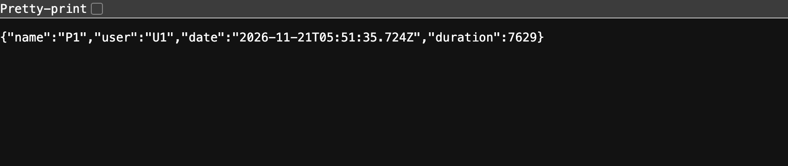
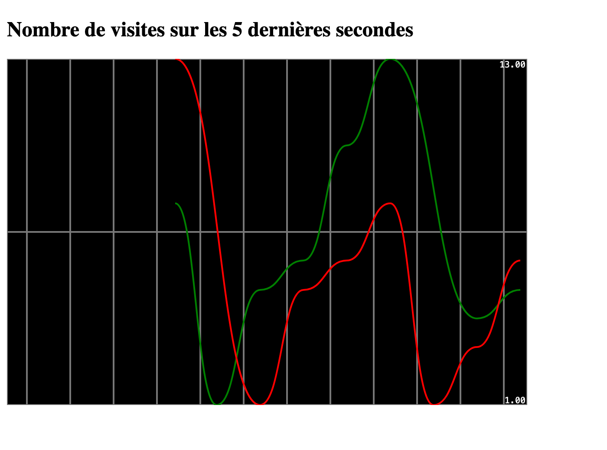

# TP3 — Apache Kafka & Spring Cloud Stream

**Réalisé par :** Mohammed EL HIMAR  
**Filière :** BDCC III

## Stack
- Java 21 / Spring Boot / Spring Cloud Stream / Kafka Streams
- Apache Kafka & Zookeeper (`confluentinc/cp-kafka:7.6.1`) via Docker Compose
- Smoothie.js (Server-Sent Events)

## 1. Démarrage de Kafka & Zookeeper
```bash
docker compose up -d
```


## 2. Publication d'un événement (`GET /publish`)
Endpoint : `http://localhost:8081/publish?name=P1&topic=T2`



## 3. Consommation des événements (`pageEventConsumer`)
Consommation depuis le topic `T2`.


## 4. Traitement en temps réel avec Kafka Streams (`kStreamFunction`)
Agrégation sur une fenêtre de 5 secondes (`T3` → `T4`).


## 5. Visualisation temps réel (`http://localhost:8081/`)
Flux SSE via `/analytics` affiché avec SmoothieChart.


